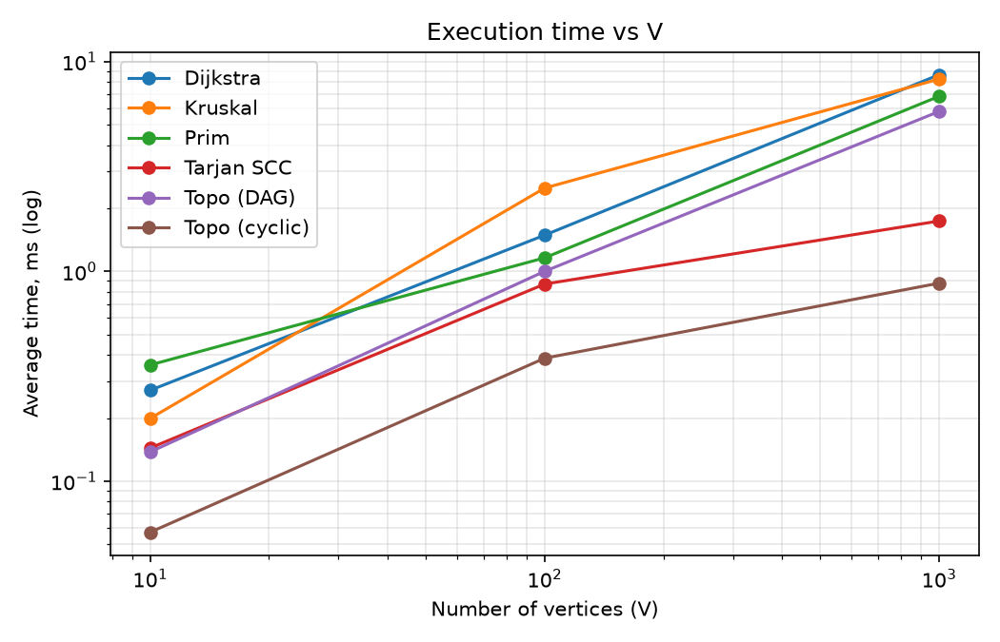
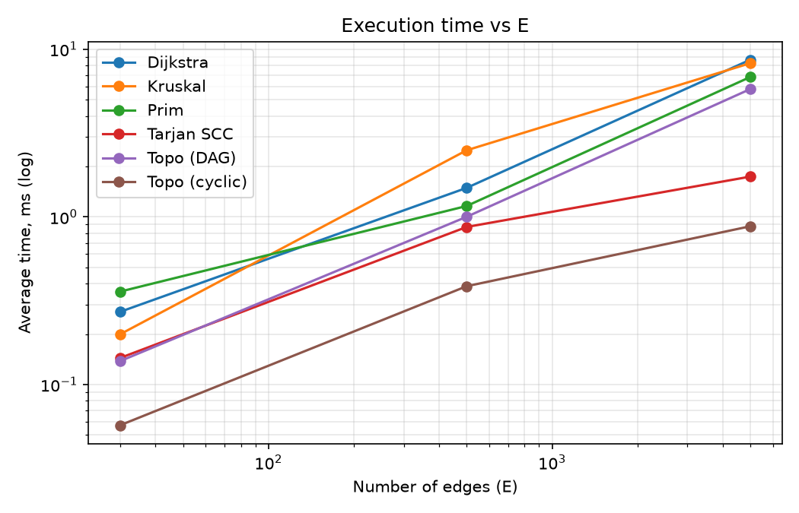
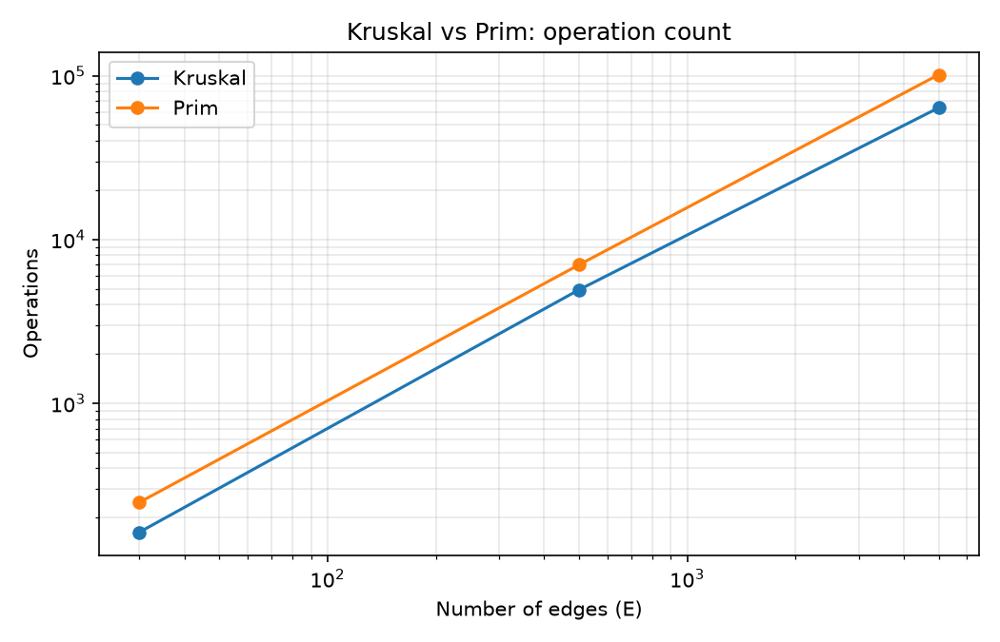

# Assignment 3 — Graph Algorithms

Bekzat Amanbek

In this assignment I took a small city road network and used it to try out the main graph algorithms from the course. The city has districts (vertices) and roads between them (edges with a cost or length). There are three tasks:

1. **Build roads as cheaply as possible** so that every district is connected → minimum spanning tree (Kruskal and Prim).
2. **Dependencies and one-way roads** → topological sort to find a valid order of tasks, and Tarjan's algorithm to find groups of districts where you can get from any district to any other.
3. **Navigation** → shortest routes from the city center with Dijkstra.

Everything is written by hand in Java, without graph libraries. I also added operation counters to the algorithms, so I could compare them by more than just time.

## Project structure

```
src/
├── graph/          Edge, Graph, DirectedGraph, GraphGenerator
├── dsu/            DSU (Union-Find)
├── mst/            Kruskal, Prim, MSTResult
├── connectivity/   TopologicalSort, TarjanSCC
├── shortestpath/   Dijkstra
└── app/            Main, Tests, Benchmark
scripts/plot.py     draws the charts
results/            CSV tables and charts
```

## How it works

Both graphs use adjacency lists. The undirected `Graph` also keeps a plain list of all edges, because Kruskal needs to sort them. For Dijkstra I convert each two-way road into two one-way edges with `toDirected()`.

**DSU.** I needed this for Kruskal. It uses path compression and union by size. I made both optimizations switchable in the constructor so I could check how much each one actually helps (spoiler: a lot, see below).

**Kruskal.** Sort the edges by weight, then go through them and take an edge if its two ends are still in different components. Stop after taking V − 1 edges. If there are fewer edges than that at the end, the graph wasn't connected, and the result says so.

**Prim.** Start from vertex 0 and keep a priority queue of the edges leaving the current tree. I used the "lazy" version: old edges stay in the queue, and when one comes out with both ends already in the tree, it's skipped.

**Topological sort.** Kahn's algorithm: repeatedly remove vertices that have no incoming edges. If some vertices are still left at the end, there is a cycle, so the method returns `null`. This makes it a cycle detector as well.

**Tarjan SCC.** A single DFS that tracks `index` and `low` values and uses a stack. When `low[v] == index[v]`, everything on the stack above `v` is one component.

**Dijkstra.** Uses a binary heap (`PriorityQueue`). Outdated queue entries are skipped, distances are stored as `long`, and `prev[]` is kept so the actual route can be printed. If the graph has a negative edge, it throws an exception instead of returning a wrong answer.

## Complexity

| Algorithm | Time | Memory |
|---|---|---|
| DSU find / union | ~O(α(V)), basically constant | O(V) |
| Kruskal | O(E log E), the sorting is the expensive part | O(V + E) |
| Prim (heap) | O(E log V) | O(E) |
| Topological sort | O(V + E) | O(V) |
| Tarjan SCC | O(V + E) | O(V) |
| Dijkstra (heap) | O((V + E) log V) | O(V + E) |

**Kruskal vs Prim.** On paper they are the same. Kruskal is easier to write and fits sparse graphs that are stored as an edge list. Prim is usually the better choice for dense graphs because it doesn't sort every edge first.

**Why Dijkstra breaks with negative weights.** Once Dijkstra takes a vertex out of the queue, it treats that distance as final. That only works because adding more edges can't make a path shorter. A negative edge breaks this. Small example: `A→B = 2`, `A→C = 3`, `C→B = −2`. Dijkstra settles B at 2 before it ever looks at C, but going through C actually costs 3 − 2 = 1. With negative weights you need Bellman-Ford, which is slower (O(V·E)).

## Experiment setup

- Laptop: AMD Ryzen 9 8945HX, 32 GB RAM, Windows 11, OpenJDK 26
- Graphs come from `GraphGenerator` with a fixed seed, so every run uses the same graphs:
  - an undirected connected graph (random spanning tree plus extra random edges), weights 1–100
  - a DAG
  - a directed graph with cycles (a DAG plus some back edges)
- Sizes: Small (V=10, E=30), Medium (V=100, E=500), Large (V=1000, E=5000)
- Each algorithm gets 3 warm-up runs, then I take the average of 5 measured runs (`System.nanoTime()`)
- While the benchmark runs, it also checks the results: Kruskal and Prim must give the same weight, the DAG order must be valid, and the cyclic graph must be detected as cyclic

## Results

### Demo on the city example

```
=== Task 1: MST ===
Kruskal: MST{weight=13, edges=5, connected=true, ...}
Prim:    MST{weight=13, edges=5, connected=true, ...}

=== Task 2: Topological order (DAG) ===
[0, 1, 2, 3, 4, 5]
Cyclic graph topo order: IMPOSSIBLE (cycle detected)
SCCs: [[5], [4, 3], [2, 1, 0]]

=== Task 3: Dijkstra from Center ===
Center: 0 via [0]
North: 4 via [0, 1]
East: 3 via [0, 2]
South: 6 via [0, 1, 3]
West: 8 via [0, 1, 3, 4]
Airport: 11 via [0, 1, 3, 5]
```

### Benchmark

MST weights were 129 / 1352 / 12303, the same for Kruskal and Prim each time. The cyclic graphs had 5 / 21 / 127 SCCs.

| Algorithm | Graph | V | E | Avg time (ms) | Operations |
|---|---|---|---|---|---|
| Kruskal | Small | 10 | 30 | 0.1995 | 163 |
| Prim | Small | 10 | 30 | 0.3584 | 248 |
| Tarjan SCC | Small | 10 | 30 | 0.1441 | 40 |
| Topo (DAG) | Small | 10 | 30 | 0.1380 | 70 |
| Topo (cyclic) | Small | 10 | 30 | 0.0572 | 42 |
| Dijkstra | Small | 10 | 30 | 0.2715 | 113 |
| Kruskal | Medium | 100 | 500 | 2.4957 | 4925 |
| Prim | Medium | 100 | 500 | 1.1611 | 6999 |
| Tarjan SCC | Medium | 100 | 500 | 0.8705 | 600 |
| Topo (DAG) | Medium | 100 | 500 | 1.0013 | 1100 |
| Topo (cyclic) | Medium | 100 | 500 | 0.3859 | 546 |
| Dijkstra | Medium | 100 | 500 | 1.4892 | 1542 |
| Kruskal | Large | 1000 | 5000 | 8.2499 | 63714 |
| Prim | Large | 1000 | 5000 | 6.8289 | 101464 |
| Tarjan SCC | Large | 1000 | 5000 | 1.7381 | 6000 |
| Topo (DAG) | Large | 1000 | 5000 | 5.7845 | 11000 |
| Topo (cyclic) | Large | 1000 | 5000 | 0.8789 | 5637 |
| Dijkstra | Large | 1000 | 5000 | 8.6539 | 15927 |





### DSU: with and without optimizations

V = 10 000. The unions build one long chain, which is the worst case for a plain DSU, and then I run 10 000 random `find` calls.

| Variant | find calls | parent steps | Avg time (ms) |
|---|---|---|---|
| none | 29998 | 49860792 | 508.7835 |
| path compression | 29998 | 19995 | 1.7740 |
| union by size | 29998 | 19996 | 1.3088 |
| both | 29998 | 19996 | 1.2678 |

## Discussion

The operation counts match the theory pretty well. On the large graph Tarjan does exactly V + E = 6000 operations, and the topological sort on the DAG does 2(V + E) = 11000, so both are clearly linear. On the cyclic graph the topological sort stops early (5637), because vertices that sit on a cycle never reach in-degree 0.

For Kruskal and Prim, going from Medium to Large made E 10 times bigger and the operation count about 13–15 times bigger. That's the extra log factor from sorting and the heap. Prim counted more operations than Kruskal (101k vs 64k) because its lazy heap can hold up to E edges and every push or poll does several comparisons. Kruskal sorts once and after that only does cheap DSU calls. The times were close, though (6.8 ms vs 8.2 ms), so at this graph density I wouldn't call either one clearly better.

Dijkstra came out slowest on the large graph. That makes sense: after `toDirected()` there are 10 000 directed edges, and every successful relaxation pushes another entry into the heap.

The DSU experiment surprised me the most. Without optimizations every `find` walks down a chain thousands of nodes long, which adds up to about 50 million steps and half a second. With just one of the optimizations it drops to around 20 thousand steps and roughly 1–2 ms. That's why the DSU part of Kruskal is almost free.

One thing to keep in mind: on the Small graphs the times are fractions of a millisecond, so they are mostly JIT warm-up and timer noise. For small inputs, operation counts are a fairer comparison. Times also change a little from run to run, but the operation counts stay the same because the seed is fixed.

## Conclusion

- Kruskal and Prim always found trees with the same weight. For a sparse road network, Kruskal with a good DSU is the simplest choice. Prim makes more sense for dense graphs.
- Topological sort and SCC are linear and were the fastest algorithms here. Topological sort also tells you whether the graph has a cycle.
- Dijkstra gives correct routes as long as no weight is negative. Otherwise you need Bellman-Ford.
- DSU optimizations matter a lot. Without them the worst case is really slow.

## Tests

`app.Tests` has 16 checks, and all of them pass:

- DSU: connected / component count
- MST: single vertex, disconnected graph (both algorithms), several possible MSTs give the same weight, Kruskal == Prim on 20 random graphs
- Topological sort: valid order on 20 random DAGs, cycle detection
- SCC: correct count, every vertex is in exactly one component, single vertex
- Dijkstra: distances, paths, unreachable vertices, negative weights are rejected

## How to run

Needs JDK 17 or newer (the code uses records). In IntelliJ, just right-click `Main`, `Tests` or `Benchmark` and choose Run. From the terminal:

```bash
javac -d out $(find src -name "*.java")
java -cp out app.Main
java -cp out app.Tests
java -cp out app.Benchmark
python scripts/plot.py
```

The charts need `pandas` and `matplotlib`.
